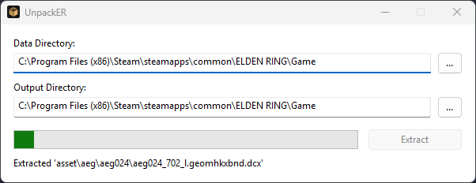

<p align="center">
    
</p>

<h1 align="center">UnpackER</h1>

**UnpackER** is a native Windows application for extracting ELDEN RING's game data for use developing mods. It's written
in C++, is multithreaded, and utilizes [WinApp](https://github.com/jakerieger/WinApp)
and [libSouls](https://github.com/jakerieger/libSouls).



## Download

*UnpackER is a Windows-only application*. You can download the latest version of UnpackER from
the [Releases](https://github.com/jakerieger/UnpackER/releases/latest) section
of this repository.

## Building

> [!IMPORTANT]
> **Requirements**: Windows, MSVC (Visual Studio 2022 or later), CMake 3.26+ and Ninja (optional but **HIGHLY**
recommended). Run the commands from a VS Developer PowerShell.

Execute the following commands:

```shell
git clone --recurse-submodules https://github.com/jakerieger/UnpackER
cd UnpackER
cmake -B build -G Ninja
cmake --build build --config Release # or Debug
```

The resulting `UnpackER.exe` lands in `build/bin` along with a `Data` directory and `Souls.dll` (libSouls).

## Acknowledgements

- [**WinApp**](https://github.com/jakerieger/WinApp) by me, a simple abstraction layer over the Win32 API for writing
  modern, native Windows applications in
  C++.
- [**libSouls**](https://github.com/jakerieger/libSouls) by me and everything it builds on, notably
  [SoulsFormats](https://github.com/JKAnderson/SoulsFormats) and [HavokLib](https://github.com/PredatorCZ/HavokLib).
- [**BinderKeys**](https://github.com/JKAnderson/BinderKeys) by TKGP and contributors (Apache 2.0): the archive keys and
  path dictionaries for ELDEN RING (and other FromSoftware games).

## License

UnpackER is licensed under the [GPL-3.0 license](LICENSE).